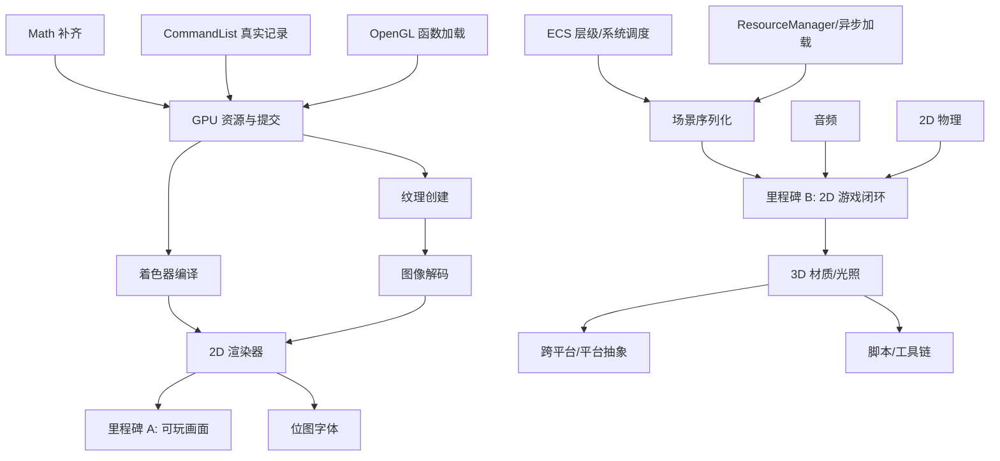

# BlackLight 引擎 - 项目任务清单

## 📋 项目概述

BlackLight 当前是“渲染设备宿主 + 少量运行时服务”的骨架：窗口、消息泵、清屏/呈现、输入快照、ECS、内容缓存、日志、固定步长和 RmlUi UI 已可用，但**渲染设备的资源创建与绘制提交全部是 `UnsupportedOperation` 空实现**，SpriteBatch 也还没有 GPU 提交路径。因此现阶段还没有“能画出游戏画面”的完整引擎。

本清单按“**先让引擎能画东西 → 再补齐运行时 → 再上玩法与 3D → 最后跨平台/工具链**”排序，每项标注难度与大致工作量，优先级由“是否阻塞后续系统”与“当前代码基础”共同决定。

---

## 🔍 现状盘点

| 模块 | 状态 | 实际情况 |
| --- | --- | --- |
| `Window` / `Game` 宿主 | ✅ 可用 | 生命周期、PImpl、退出、可变/固定更新、异常清理 |
| `RenderingDevice`（窗口层） | ✅ 可用 | OpenGL / D3D11 创建或附着 HWND、事件泵、清屏、Present |
| `RenderingDevice`（资源层） | ❌ 空壳 | `CreateBuffer` / `CreateTexture` / `CreateGraphicsPipeline` / `Submit` 全部抛异常 |
| `CommandList` | ❌ 空壳 | 只累加 `draw_count`，不保存任何命令 |
| `SpriteBatch` | ⚠️ 半成品 | 只做收集与排序，无顶点上传、无纹理、无提交回调实现 |
| `ContentManager` | ⚠️ 基础 | 仅二进制/文本文件缓存；无图片、模型、音频、着色器加载 |
| `InputState` | ⚠️ 基础 | 512 个裸 VK 码 + 鼠标按键；无按键枚举、鼠标 delta、文本输入、手柄 |
| `World`（ECS） | ⚠️ 基础 | 类型池 + `Each`；无层级、系统调度、延迟销毁、序列化、反射 |
| `Math` | ⚠️ 基础 | `Vector2/3`、`Color`、`Matrix4`；无旋转/投影/求逆/四元数/包围盒 |
| `Logger` / `Time` | ✅ 可用 | 级别过滤、文件、自定义 sink；`FrameClock` 固定步长 |
| RmlUi / `.bui` | ✅ 仅 OpenGL | GL2 渲染器 + Win32 平台；D3D11 无 UI 适配 |
| 音频 / 物理 / 脚本 / 网络 | ❌ 缺失 | 无任何实现 |
| 测试 | ⚠️ 极少 | 仅 `LoggerTests.cpp`；渲染、ECS、内容均无测试 |

> 结论：**第一优先级不是加新系统，而是把渲染设备的资源层和命令提交补成真实实现。** 否则 SpriteBatch、材质、模型、3D 管线都无从谈起。

---

## 🏷️ 难度与优先级标记

- ★☆☆ 简单：约 0.5–1 人日，改动局部、无外部依赖
- ★★☆ 中等：约 2–5 人日，需要设计接口或接入依赖
- ★★★ 困难：1–2 周以上，涉及架构调整或第三方集成
- **P0**：阻塞其他系统，先做
- **P1**：形成 2D 游戏闭环必需
- **P2**：3D 与内容生产能力
- **P3**：平台化、工具链与 polish

---

## 🚀 第一阶段：渲染设备补全（P0，当前最大缺口）

### 1.1 资源与命令提交

- [x] **`CommandList` 真实记录命令**：变体队列保存 pipeline / vertex buffer / index buffer / viewport / uniform / texture / draw；成功提交后清空，失败时保留 — ★★☆（2–3d）
- [x] **资源句柄绑定后端对象**：资源携带设备身份与后端对象，命令捕获强引用；设备关闭前清理仍存活对象，GL 删除延迟到上下文线程 — ★★☆（2–3d）
- [x] **OpenGL 函数加载器**：运行时加载本实现使用的 GL 3.3 VBO/VAO/FBO/Shader/Sampler 函数，不引入 GLEW/GLAD — ★★☆（2–3d）
- [x] **OpenGL 资源创建**：顶点/索引/常量/不透明 Storage Buffer 分配、2D 纹理、采样状态；3.3 不支持可着色器读写的 SSBO — ★★☆（3–5d）
- [x] **OpenGL 提交执行**：绑定 VAO/管线/纹理、设置 viewport、执行 indexed/non-indexed draw — ★★☆（2–3d）
- [x] **D3D11 提交执行**：Buffer、Texture/SRV、InputLayout、RSSetViewports、Draw/DrawIndexed — ★★☆（3–5d）
- [x] **常量与 uniform 绑定 API**：`CommandList::SetUniform` / `SetTexture`，支持 float、vec2/3/4、mat4、命名纹理槽 — ★★☆（2–3d）
- [x] **统一管线状态**：深度测试/写入、剔除、混合、sRGB、MSAA 纹理采样数与颜色 resolve 已接入；深度目标可渲染但不可 resolve — ★★☆（2–3d）
- [x] **着色器编译**：GLSL 运行时编译；D3D11 使用 `D3DCompile`；编译与链接诊断写日志 — ★★☆（2–3d）
- [x] **纹理格式映射**：已映射 `ResourceFormat` 到 GL internal format / DXGI format，支持 sRGB 和完整紧密排列 mip 链 — ★☆☆（1–2d）
- [x] **Render Target / 离屏渲染**：颜色纹理可创建 framebuffer/RTV，D24S8 可作深度附件，`BeginFrame` 可切换目标 — ★★★（1 周）
- [x] **设备能力查询**：`DeviceCapabilities` 提供纹理尺寸、MRT、compute、storage-buffer 与 MSAA 上限/支持位 — ★☆☆（1d）

实现约束与 ABI、资源生命周期和后端差异见 [渲染设备 1.1 实施记录](../docs/rendering-device-1.1.md)。

### 1.2 后端一致性

- [x] **D3D11 窗口缩放**：处理 `WM_SIZE`，释放 RTV 并 `ResizeBuffers`，重建 RTV/深度缓冲 — ★☆☆（1d）
- [x] **D3D11 输入转发**：键鼠、滚轮、失焦清空，行为与 OpenGL 后端一致 — ★☆☆（1d）
- [x] **D3D11 深度缓冲与 viewport**：创建 D24S8 深度模板，`BeginFrame` 设置 viewport — ★☆☆（1d）
- [x] **D3D11 RmlUi 适配**：接入 RmlUi D3D11 渲染器，删掉 `RenderUi` 空实现 — ★★☆（3–5d）
- [x] **设备丢失处理**：DXGI `DEVICE_REMOVED`/`RESET` 与 OpenGL 上下文丢失的恢复路径 — ★★★（1 周）

### 1.3 2D 立即可用

- [ ] **图像解码**：用 Windows Imaging Component（或 `stb_image`）解码 PNG/JPG，创建 `Texture` — ★☆☆（1–2d）
- [ ] **SpriteBatch GPU 渲染器**：动态顶点缓冲 + 白纹理 + 正交投影 + 按纹理分批 — ★★☆（2–3d）
- [ ] **Camera2D / 正交相机**：屏幕、世界坐标互转，视口与缩放 — ★☆☆（1–2d）
- [ ] **帧统计**：FPS、CPU 帧时间、draw call、顶点数、纹理切换次数 — ★☆☆（1d）
- [ ] **位图字体与 TextRenderer**：精灵字体渲染（HUD 与调试文本）— ★★☆（2–3d）
- [ ] **纹理图集与帧动画**：Atlas 打包、帧序列、播放控制 — ★★☆（2–3d）
- [ ] **GPU 计时**：GL timer query / D3D11 disjoint query（可延后）— ★★☆（2–3d）

> **里程碑 A（第一个可玩画面）**：OpenGL 后端下用 `ContentManager` 加载 PNG → 创建纹理 → `SpriteBatch` 每帧提交 → 屏幕出现可移动/旋转的精灵，并显示 FPS。

---

## 🧱 第二阶段：引擎基础服务（P1）

### 2.1 数学库

- [ ] **补齐基础类型**：`Vector4`、`Quaternion`、`Matrix3`、`Color` 混合/线性插值 — ★☆☆（1d）
- [ ] **矩阵能力**：旋转（欧拉/四元数）、透视、正交、求逆、转置、变换点/向量 — ★☆☆（1–2d）
- [ ] **几何类型**：`Rect`、`AABB`、`Sphere`、`Ray`、`Plane` 与相交测试 — ★☆☆（1–2d）
- [ ] **相机矩阵**：`LookAt`、View、Projection、视锥平面提取 — ★☆☆（1d）
- [ ] **数学单测**：矩阵乘法/求逆/投影的数值回归 — ★☆☆（1d）

### 2.2 输入与时间

- [ ] **`KeyCode` 枚举**：替换裸 VK 码，提供 Win32 映射与 `ToString` — ★☆☆（1d）
- [ ] **鼠标增强**：位移 delta、双击、光标捕获/隐藏/边界限制 — ★☆☆（1d）
- [ ] **文本输入**：`WM_CHAR` + IME 组合输入，供 UI 与游戏内输入框 — ★★☆（2–3d）
- [ ] **手柄输入**：XInput 接入，死区、震动 — ★★☆（2–3d）
- [ ] **输入映射**：Action/Axis 抽象，运行时可重绑定 — ★☆☆（1–2d）
- [ ] **定时器/秒表**：游戏内 `Timer`、冷却、延迟调用 — ★☆☆（0.5d）

### 2.3 诊断

- [ ] **断言宏**：`BL_ASSERT` / `BL_VERIFY`，失败回调与断点 — ★☆☆（0.5d）
- [ ] **崩溃处理**：SEH 捕获 + minidump 输出 — ★★☆（2d）
- [ ] **日志分类过滤**：每个 category 独立级别 — ★☆☆（1d）
- [ ] **作用域性能计时**：`BL_PROFILE_SCOPE` 输出到日志/chrome tracing — ★★☆（2d）

### 2.4 资源与 IO

- [ ] **`ResourceManager` / `AssetHandle`**：纹理、着色器、材质、字体的引用计数、句柄化与热重载 — ★★☆（3–5d）
- [ ] **异步加载**：后台线程读盘/解码，主线程创建 GPU 资源 — ★★☆（3d）
- [ ] **线程池 / JobSystem**：任务窃取或简单队列，供资源与场景加载使用 — ★★☆（3d）
- [ ] **文件监视热重载**：`ReadDirectoryChangesW` 监听资源/着色器变更 — ★★☆（2d）
- [ ] **虚拟文件系统**：目录 + pak 包（打包与挂载）— ★★★（1–2 周）

### 2.5 ECS 与场景

- [ ] **Transform 层级**：父子关系、世界矩阵缓存、脏标记传播 — ★★☆（3d）
- [ ] **系统调度**：`System` 注册、执行阶段与顺序、每帧/固定步回调 — ★★☆（3d）
- [ ] **延迟销毁**：`Each` 中安全增删实体/组件，销毁延迟到帧末 — ★☆☆（1–2d）
- [ ] **组件反射元数据**：字段名/类型/范围/序列化，供场景与编辑器共用 — ★★☆（3–5d）
- [ ] **场景序列化**：JSON 保存/加载实体、组件、资源引用 — ★★☆（3–5d）
- [ ] **Prefab / 实体模板**：复用实体结构与默认组件 — ★★★（1 周）
- [ ] **场景切换与加载**：同步加载、卸载、过渡 — ★★☆（2–3d）
- [ ] **多世界隔离**：编辑器预览与运行时分离（可选）— ★★★（1 周）

> **里程碑 B（2D 游戏闭环）**：场景 JSON 保存/加载 + Transform 层级 + 系统调度 + 输入映射 + 音频播放 + SpriteBatch 渲染。

---

## 🔊 第三阶段：音频与 2D 物理（P2）

### 3.1 音频

- [ ] **音频设备抽象**：XAudio2 或 WASAPI，初始化/关闭/主音量 — ★★☆（3d）
- [ ] **音频解码**：WAV（`dr_wav`）与 OGG（`stb_vorbis` / `dr_mp3`）— ★★☆（2–3d）
- [ ] **通道与混音**：SFX/音乐总线、音量、暂停、淡入淡出 — ★★☆（2–3d）
- [ ] **流式音乐播放**：大文件分块解码 — ★★☆（2d）
- [ ] **3D 音频**：听者、距离衰减、声道定位 — ★★★（1 周）

### 3.2 物理与碰撞

- [ ] **2D 碰撞基础**：AABB/Circle、射线、扫掠检测 — ★☆☆（2–3d）
- [ ] **简单 2D 刚体**：速度/加速度/重力/摩擦积分 — ★★☆（2–3d）
- [ ] **触发器与碰撞事件**：层/掩码过滤、enter/stay/exit 回调 — ★★☆（2–3d）
- [ ] **3D 物理集成**：Jolt Physics，ECS 组件映射与固定步同步 — ★★★（1–2 周）
- [ ] **角色控制器**：胶囊体、斜坡、台阶 — ★★★（1 周）

---

## 🎨 第四阶段：3D 渲染与内容生产（P2 / P3）

- [ ] **网格与模型加载**：OBJ 起步，glTF 2.0（网格/材质/骨骼）后续 — ★★☆（OBJ 2d / glTF 1–2 周）
- [ ] **材质系统**：参数块、纹理槽、变体/关键字，取代裸管线 — ★★☆（1 周）
- [ ] **内置 3D 管线**：MVP 变换、深度、背面剔除 — ★★☆（3–5d）
- [ ] **前向光照**：方向光/点光/聚光、法线、简单 PBR 或 Lambert — ★★★（2 周）
- [ ] **阴影贴图**：方向光 CSM、偏差处理 — ★★★（1–2 周）
- [ ] **后处理**：色调映射、Bloom、FXAA、抗锯齿 — ★★★（1–2 周）
- [ ] **骨骼动画与蒙皮**：骨骼层次、权重、动画采样 — ★★★（2–3 周）
- [ ] **粒子系统**：发射器、生命周期、曲线、GPU 粒子 — ★★☆（1 周）
- [ ] **天空盒与地形**：天空盒、地形高度图/分块 — ★★★（1–2 周）
- [ ] **RenderGraph / RenderPass**：资源依赖、自动屏障、通道排序 — ★★★（2–3 周）
- [ ] **剔除**：视锥剔除、遮挡剔除、空间划分（BVH/四叉树）— ★★★（1–2 周）
- [ ] **GPU 资源池与统计**：纹理/缓冲复用、显存统计 — ★★☆（1 周）

---

## 🌐 第五阶段：平台化与工具链（P3）

- [ ] **平台抽象层**：文件、线程、时间、动态库、窗口/消息从 Win32 抽出 — ★★★（2 周）
- [ ] **跨平台窗口/上下文**：GLFW 或 SDL3，先 Linux 再 macOS — ★★★（2–3 周）
- [ ] **跨平台图形后端**：Vulkan / Metal，或至少 OpenGL 核心配置对齐 — ★★★（1 个月+）
- [ ] **资源烘焙**：纹理压缩（BCn）、着色器变体预编译、Atlas 构建 — ★★★（2 周）
- [ ] **打包格式**：资源 pak、版本与校验 — ★★☆（1 周）
- [ ] **脚本绑定**：Lua 优先（sol2），C# 可选 — ★★★（2–4 周）
- [ ] **反射注册表与编辑器对接**：组件字段、Gizmo、属性面板数据源 — ★★☆（1–2 周）
- [ ] **网络**：传输层（ENet/asio）+ 序列化 + 快照/插值 — ★★★（1 个月+）
- [ ] **本地化**：文本表、字体回退、RTL — ★★☆（1 周）
- [ ] **热重载**：着色器/资源/脚本 — ★★★（1–2 周）

---

## 🧪 第六阶段：测试、文档与稳定性（贯穿全程）

- [ ] **补齐单测**：Math、ECS（含延迟销毁）、Content、CommandList、SpriteBatch — ★☆☆（3–5d）
- [ ] **空后端/虚拟设备**：无 GPU 的 CI 渲染测试 — ★★☆（3d）
- [ ] **集成测试**：设备初始化 → 创建资源 → 提交 → 关闭的完整链路 — ★★☆（2–3d）
- [ ] **警告清零**：MSVC C4251、未使用参数、`/W4` 全绿 — ★☆☆（1–2d）
- [ ] **静态分析/Sanitizer**：ASan、clang-tidy 接入 CI — ★★☆（2–3d）
- [ ] **性能基准**：Sprites、draw call、资源加载吞吐 — ★★☆（3d）
- [ ] **文档**：每个系统的使用指南与最小示例，更新 `docs/rendering-device.md` — ★☆☆（持续）
- [ ] **示例项目**：2D 精灵示例、场景示例、UI 示例 — ★★☆（3–5d）

---

## 🎯 优先级汇总

### P0（阻塞项，先做）
1. `CommandList` 真实记录 + 资源句柄后端绑定
2. OpenGL 函数加载 + Buffer/Texture/Pipeline + 提交
3. 着色器编译（GLSL / D3DCompile）
4. 图像解码 + 纹理上传
5. SpriteBatch GPU 渲染器 + Camera2D
6. 帧统计
7. Math 补齐（并行进行，几乎无依赖）

### P1（2D 游戏闭环）
- D3D11 缩放/输入/深度补齐
- 输入 KeyCode/delta/文本/手柄 + 输入映射
- ECS Transform 层级、系统调度、延迟销毁
- 场景 JSON 序列化、Prefab、场景切换
- ResourceManager + 异步加载 + 热重载
- 音频播放与 2D 碰撞
- 断言、崩溃处理、单测

### P2（内容生产与 3D）
- D3D11 资源/提交与 RmlUi 适配
- 模型、材质、光照、阴影、后处理
- 粒子、骨骼动画、RenderGraph/剔除
- 3D 物理

### P3（平台与工具）
- 平台抽象、跨平台后端、资源烘焙、脚本、网络
- 性能与稳定性 polish

---

## 📊 建议实施顺序（按现有代码基础与依赖）

| 顺序 | 任务 | 难度 | 理由 |
| --- | --- | --- | --- |
| 1 | Math 补齐 | ★☆☆ | 纯 header、零依赖，后续全部系统需要 |
| 2 | `CommandList` 记录 + 资源句柄设计 | ★★☆ | 决定公开 ABI，越早越省返工 |
| 3 | OpenGL 函数加载 + 资源创建 | ★★☆ | 现有唯一带 UI 的可运行后端，先打通 |
| 4 | 着色器编译 + 纹理格式映射 | ★★☆ | 资源能创建后的第一道使用门槛 |
| 5 | 图像解码 + `CreateTexture` | ★☆☆ | 让 SpriteBatch 有真实纹理可用 |
| 6 | SpriteBatch GPU 渲染器 + Camera2D | ★★☆ | **里程碑 A**：第一次画出游戏画面 |
| 7 | FrameStats | ★☆☆ | 后续所有性能工作的观测基础 |
| 8 | D3D11 缩放/输入/深度 | ★☆☆ | 消除后端行为差异，成本低 |
| 9 | D3D11 资源与提交 | ★★☆ | 与 OpenGL 对齐，避免长期单后端 |
| 10 | ECS Transform + 系统调度 | ★★☆ | 场景与玩法逻辑的基础 |
| 11 | 场景 JSON + ResourceManager | ★★☆ | **里程碑 B**：可保存/加载的 2D 游戏 |
| 12 | 音频 + 2D 碰撞 | ★★☆ | 2D 玩法闭环的最后两块 |
| 13 | 材质/模型/光照 | ★★★ | 进入 3D 内容生产 |
| 14 | 平台抽象与跨平台 | ★★★ | 在渲染架构稳定后再动 |

---

## 🔗 依赖关系

---

## ⚠️ 注意事项

1. **不要先做 3D/脚本/跨平台**：设备连一个三角形都画不出来时，这些投入会被架构返工吞掉。
2. **公开头文件先定 ABI**：`CommandList` 的 uniform/纹理绑定、`Buffer`/`Texture` 的设备归属会长期影响 SDK 使用者，设计时同步更新 `docs/rendering-device.md`。
3. **资源释放顺序**：`Texture`/`Buffer` 必须在设备 `Shutdown()` 前释放，或由设备延迟回收；现有 `Window` 生命周期已要求 UI 树先于上下文销毁，资源层要沿用同一规则。
4. **后端能力差异显式化**：OpenGL 兼容上下文与 D3D11 的纹理格式、深度约定不同，尽早引入 `DeviceCapabilities` 与明确的降级策略。
5. **每阶段可验证**：每个 P0/P1 任务都应附带最小可运行示例或单测（例如“创建纹理并采样到屏幕”），避免出现“接口完成但从未跑通”的再次空壳。
6. **测试设备无关化**：为 CommandList/SpriteBatch/ResourceManager 引入空后端，使 CI 不依赖 GPU。

---

**最后更新**：2026-11-12
